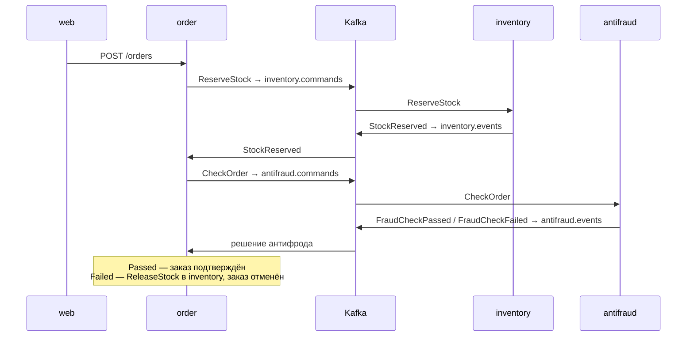

# Техносад — учебный магазин на Kafka

Учебный проект для практики с Apache Kafka на Python. Это интернет-магазин техники Apple:
заказ проходит через несколько независимых сервисов, которые общаются только через Kafka.
Сначала товар резервируется на складе, затем заказ проверяет антифрод. Если проверка не
пройдена, резерв автоматически снимается (паттерн Saga).

> Магазин вымышленный: заказы не оплачиваются и не доставляются. Проект не связан с Apple Inc.

## Стек

- **Kafka** 4.3 в режиме KRaft (без ZooKeeper), клиент **aiokafka**
- **Python** 3.12, FastAPI, SQLAlchemy 2 (async), Alembic, pydantic
- **PostgreSQL** 17 — у каждого сервиса своя база
- **Фронтенд:** Jinja2-шаблоны, HTMX, свой CSS
- Docker Compose, uv, pytest + testcontainers, ruff, mypy, GitHub Actions

## Как работает Kafka в проекте

| Сервис | Что делает |
|---|---|
| `web` | Витрина: каталог, корзина, оформление, живой статус заказа |
| `order` | Принимает заказы и ведёт сагу: решает, какой шаг следующий |
| `inventory` | Каталог и склад: резервирует товар и снимает резерв |
| `antifraud` | Проверяет заказ по правилам: крупная сумма, частые заказы, новая страна |



**Топики:** `inventory.commands`, `inventory.events`, `antifraud.commands`, `antifraud.events`,
и для каждого — `*.dlq` для сообщений, которые не удалось обработать.

**Как обеспечена надёжность:**

- **Transactional Outbox.** Сервис пишет изменение в БД и сообщение в таблицу `outbox`
  одной транзакцией, а отдельный процесс переносит сообщения в Kafka. Если Kafka
  недоступна, заказы всё равно принимаются, а сообщения уходят, когда она вернётся.
- **Идемпотентный консьюмер.** Kafka может доставить сообщение дважды, поэтому id
  обработанных сообщений сохраняются, а повторы пропускаются. Оффсет коммитится только
  после коммита в БД.
- **Повторы и DLQ.** Временная ошибка — до 3 попыток с паузой. Битое сообщение сразу
  уходит в DLQ, и консьюмер идёт дальше, не блокируя партицию.
- **Ключи партиций.** Сообщения заказа идут с ключом `order_id` и обрабатываются по
  порядку. Проверки антифрода идут с ключом `user_id`, чтобы заказы одного покупателя
  проверялись в порядке создания.

## Запуск

```bash
docker compose up -d
```

- Витрина: http://localhost:8000 (покупателя можно сменить в шапке)
- Kafka UI: http://localhost:8080 — топики и сообщения
